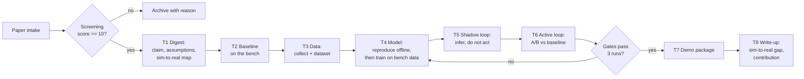

# AI-RAN Native: product requirements, flow and workflow (draft)

Status: **draft PRD** (2026-11-16), for review. Nothing on the bench changes because of this document; every bench
change still needs the owner's OK.

FCT Lab (Future Communication Translation Lab) translates concepts into products that can be demonstrated. This
document defines the product **"AI-RAN Native on the FCT testbed"**: a repeatable way to take an AI-for-RAN paper
whose results come only from simulation, run it in closed loop on the lab's real 5G SA stack, measure how much of the
paper's claim survives, and package the result as a live demo.

## Summary
| Question | Answer |
|---|---|
| Product | A **paper-to-demo pipeline** plus the **platform** it runs on: AI models in closed loop with a real 5G SA stack (OAI and OCUDU cells, Open5GS core), observed and controlled through standard interfaces |
| Unit of work | A **Translation** (`TR-NN`): one paper → one bench reproduction → one demo, tracked like an experiment |
| Main output per Translation | A live demo (≤ 10 min, scripted, repeatable), a result page with the **sim-to-real gap** (paper's claim vs bench measurement), and the scripts that reproduce it with PASS gates |
| Users | Lab researchers (run Translations), demo audiences (partners, clients, students), the AI-RAN community (results, datasets) |
| Built on | The verified testbed: EXP-00/00b/00c/01 (noise → SINR → CQI/MCS → capacity curves), EXP-16 (second cell on OCUDU), EXP-17 (coverage replay from real logs, AI multilink steering) |
| Biggest platform gap | No **near-RT RIC / E2** yet (EXP-12 planned): today the AI can observe through the dashboard/Prometheus and act through scripts, not through a standard RAN control interface |
| Hard limits | RF simulator / ZMQ only (no over-the-air), so no beams, no real fading, no positioning; single-UE cells today; CPU-bound PHY |

## 1. Problem
- Most AI-for-RAN papers evaluate on system-level simulators or recorded traces. Their gains depend on assumptions
  (channel model, traffic, perfect measurements, no latency in the control loop) that a real stack does not honour.
- Partners and clients cannot see these ideas working; a slide with a simulation curve does not sell a product.
- The lab already has a verified testbed with controllable radio conditions and real-data replay, but no standard
  path from "interesting paper" to "demo that runs on Monday".

## 2. Goals and non-goals
**Goals**
1. G1: Every Translation ends in a **live demo** that runs from one script and passes its gates three times in a row.
2. G2: Every Translation reports the **sim-to-real gap** honestly: which of the paper's claims hold, which do not, why.
3. G3: An **AI-RAN platform layer** reusable across Translations: data collection, model hosting, closed-loop
   control (observe → infer → act) with measured loop latency.
4. G4: Translation cycle time drops: the first one in ~8 weeks, later ones in ~3-4 weeks.
5. G5: Results the community can use: method write-ups, datasets (where the data owner agrees), contributions in
   the AI-RAN Alliance and O-RAN framing.

**Non-goals (this phase)**
- Over-the-air radio, real beams, MIMO channel realism, positioning (rfsim cannot support the claim).
- Training foundation models; we host and adapt small models.
- Commercial-grade RIC or SMO; we use open-source components sized for the bench.
- Reproducing a paper whose core claim depends only on the physical channel (section 5, screening).

## 3. Framing: what "AI-RAN native" means here
Three pillars (AI-RAN Alliance terms), and where each Translation sits:

| Pillar | Meaning | On this testbed |
|---|---|---|
| **AI-for-RAN** | AI inside the RAN control loops: link adaptation, scheduling, mobility, load balancing, energy saving, anomaly detection | Main focus. Loop through E2 (after EXP-12) or through the gNB's own config/telnet hooks before that |
| **AI-and-RAN** | RAN and AI workloads share the same compute | Measure: gNB + model on the same host / Jetson; CPU/GPU headroom, loop latency under load |
| **AI-on-RAN** | AI applications that use the RAN | EXP-17 (multilink steering on the ship router) is the first example |

Control-loop time scales (O-RAN): non-RT (> 1 s, rApps), near-RT (10 ms - 1 s, xApps), real-time (< 10 ms, inside
the gNB). The bench can host non-RT and near-RT loops; real-time loops need code inside the OAI/OCUDU scheduler and
are taken only when the paper's gain needs them.

## 4. Platform requirements
What has to exist so that a Translation is mostly "plug the model in". Each item gets its own stage with a gate.

| ID | Requirement | Today | Gap / work |
|---|---|---|---|
| P1 | **Controllable radio conditions** per cell, scripted, read back | OAI: channelmod noise via the noise relay (EXP-00), coverage replay from logs (EXP-17 M2) | OCUDU cell: no channel model (EXP-17 risk 1) |
| P2 | **Observability**: per-UE SINR, CQI, MCS, BLER, PRB, goodput, latency, at ≤ 1 s | Dashboard + Prometheus (30 days), KPI page | Export as a dataset with a schema; per-TTI data not exposed |
| P3 | **Standard control interface**: E2 (KPM for monitoring, RC for control) | None | EXP-12: near-RT RIC (FlexRIC) + E2 agent on the OAI gNB; check OCUDU E2 support |
| P4 | **Model hosting** near the RAN: inference service with a fixed API, version pinning | Jetson Orin NX used as ship router (EXP-17) | One serving pattern (container + REST/gRPC), on REDLAB CPU and on the Jetson GPU |
| P5 | **Closed-loop harness**: observe → infer → act, with logging of every decision and the loop latency | Ad hoc per experiment (EXP-17 replay script) | Generic harness; shadow mode (infer, do not act) and active mode |
| P6 | **Traffic and scenario library**: UDP/TCP load, traffic classes, replayed coverage, multi-UE | iperf3 pods, EXP-17 profiles | More UEs per cell (OAI nrUE multi-instance), scripted traffic mixes |
| P7 | **Baselines**: the non-AI rule the paper compares against (OLLA, round robin, fixed thresholds, ATSSS modes) | Native gNB behaviour | Implemented or configured per Translation |
| P8 | **Demo surface**: one screen showing conditions, AI decisions and KPIs live, AI on/off toggle | Dashboard | Demo view per Translation, AI on/off A/B switch |
| P9 | **Data rules**: client data outside the public repo; SIM values in Secrets | Enforced (EXP-17) | Same rules for every Translation dataset |
| P10 | **Core exposure**: the AI reads core events and analytics and asks the core for QoS through 3GPP service APIs (NWDAF, NEF, event exposure, policy authorization) | Open5GS 2.8.0 serves the core's own NF-to-NF services only (section 4.1); of the exposure APIs only `Npcf_PolicyAuthorization` exists | Decide D6: add an NWDAF/NEF from another open-source core next to Open5GS, move to a core that has them, or keep core data on Prometheus and the gNB side |

### 4.1 Core API support (Open5GS 2.8.0, checked 2026-11-19)
Checked against the 3GPP OpenAPI files collected in [jdegre/5GC_APIs](https://github.com/jdegre/5GC_APIs) (Rel-18,
about 270 APIs), by reading the Open5GS v2.8.0 source: the services each NF registers with the NRF
(`ogs_sbi_nf_service_build_default`) and the resources its state machine handles. Open5GS ships the 3GPP YAML files
and generated C models for many more APIs than it serves; a model in the tree does not mean a service. **Not yet
confirmed on the live core** (NRF query on tiny pending).

| NF (deployed) | Served | Not served (examples) |
|---|---|---|
| NRF | `Nnrf_NFManagement`, `Nnrf_NFDiscovery` (TS 29.510) | `Nnrf_AccessToken` (OAuth2), `Nnrf_Bootstrapping` |
| AMF | `Namf_Communication` (TS 29.518), partly: UE contexts, N1/N2 message transfer | `Namf_EventExposure`, `Namf_Location`, `Namf_MT`, MBS |
| SMF | `Nsmf_PDUSession` (TS 29.502) | `Nsmf_EventExposure` (TS 29.508), `Nsmf_NIDD` |
| AUSF | `Nausf_UEAuthentication` (TS 29.509: 5G-AKA, EAP-AKA') | `Nausf_SoRProtection`, `Nausf_UPUProtection` |
| UDM | `Nudm_UEAU`, `Nudm_SDM`, `Nudm_UECM` (TS 29.503) | `Nudm_EE`, `Nudm_PP`, `Nudm_MT`, `Nudm_UEID` |
| UDR | `Nudr_DR` (TS 29.504: subscription, authentication, context and policy data) | `Nudr_GroupIDmap`; application and exposure data (TS 29.519) |
| PCF | `Npcf_AMPolicyControl` (29.507), `Npcf_SMPolicyControl` (29.512), `Npcf_PolicyAuthorization` (29.514, N5) | `Npcf_UEPolicyControl`, `Npcf_EventExposure`, `Npcf_BDTPolicyControl` |
| BSF | `Nbsf_Management` (TS 29.521) | |
| NSSF | `Nnssf_NSSelection` (TS 29.531) | `Nnssf_NSSAIAvailability` |
| SCP | Indirect communication (routes the above) | |

Not in Open5GS at all: NWDAF (TS 29.520: analytics, ML model provision/training), NEF and the northbound APIs
(TS 29.522, 29.591, 29.551, 29.122 T8), CAPIF (TS 29.222), `Nupf_EventExposure` (TS 29.564), CHF, NSACF, LMF/GMLC,
MBS, edge (TS 29.558), 5G-EIR, SMSF. Open5GS's SEPP (N32 handshake, TS 29.573) exists but is not deployed here.
Outside the 3GPP APIs, Open5GS exposes Prometheus metrics (already scraped by the dashboard) and a WebUI for
subscribers.

For the PRD this means: an AF on the bench can ask for QoS on a flow through `Npcf_PolicyAuthorization` (a candidate
actuation for AI-on-RAN, to be tested), but the analytics and event APIs an AI-native core would use are missing.

## 5. Paper screening (which papers to translate)
Score each candidate 0-2 per criterion; translate those with total ≥ 10 and no 0 on T1 or T2.

| # | Criterion | 2 = | 0 = |
|---|---|---|---|
| T1 | **Testbed fit**: the claim lives in a layer the bench reproduces | MAC/RRC/core/traffic/multilink | Depends on the physical channel or antennas (beams, MIMO CSI, positioning) |
| T2 | **Observables exist**: inputs the model needs are measurable on the bench | Already in Prometheus or E2 KPM | Needs per-TTI PHY data we cannot expose |
| T3 | **Actuation exists**: the knob the model turns can be turned | Config/telnet/E2 RC available | Needs scheduler code changes |
| T4 | **Model size**: trains and runs on lab compute | Small (trees, bandits, small NN, RL with small state) | Large models or long RL training needing a simulator |
| T5 | **Baseline clear**: a non-AI reference is defined and reproducible | Yes | Vague |
| T6 | **Demo value**: an audience sees the difference within minutes | Visible KPI gap (outage, throughput, energy) | Gain only in long-run averages |
| T7 | **Lab/partner relevance** (maritime, private 5G, education) | Direct | None |

Use-case catalog to draw candidates from (3GPP TR 37.817 for NG-RAN AI/ML, TR 38.843 for the air interface, O-RAN
use cases), with a first fit rating:

| Use case | Fit | Reason |
|---|---|---|
| ML link adaptation / MCS selection (beyond OLLA) | **High** | Noise control + SINR→MCS curves (EXP-00b) + BLER visible |
| Traffic / KPI prediction, anomaly detection (RAN or N2) | **High** | Observability exists; EXP-15 planned for N2 |
| Multilink / access steering (AI-on-RAN) | **High** | EXP-17 in progress |
| Slice-aware scheduling, PRB allocation by xApp | Medium | Needs E2 RC (P3) and several UEs (P6) |
| Load balancing / mobility between the two cells | Medium | Two cells exist (OAI + OCUDU); handover between them not yet tested |
| Energy saving (cell/carrier off, PRB reduction) | Medium | Bench power is not representative; can show the decision logic and KPI cost |
| CSI compression, beam management, positioning (TR 38.843) | Low | rfsim has no realistic MIMO/beam channel |

## 6. The Translation flow

## 7. Workflow per stage
Each stage ends with a scripted gate (PASS/FAIL output), as in the experiments. A stage that fails goes back, never
forward with a hypothesis presented as a result.

| Stage | Input | Work | Output | Gate |
|---|---|---|---|---|
| **T0 Intake** | Paper (PDF, link) | Fill the screening score (section 5) | `TR-NN` issue with score | Score ≥ 10, owner agrees |
| **T1 Digest** | Paper | Claim in one sentence; the paper's numbers to beat; every assumption mapped to the bench (holds / emulated / impossible); the paper's own simulator setup | `TR-NN.md` sections 1-3 | No "impossible" assumption carries the main claim |
| **T2 Baseline** | Digest | Run the paper's non-AI baseline on the bench, same scenario as the paper as far as the bench allows | Baseline KPIs, 3 runs | Repeatable (spread within stated tolerance) |
| **T3 Data** | Baseline scenario | Collect the model's inputs and labels from the bench (P2); data schema, train/test split by time or route | Dataset (outside the repo if it holds client data) | Schema check; no missing input over the run |
| **T4 Model** | Dataset, paper | (a) Reproduce the paper's result in its own simulation if code/setup is available; (b) train on bench data; offline metrics | Model artefact, pinned version | Offline metric meets the paper's reported figure or the gap is explained |
| **T5 Shadow** | Model | Run in the loop, log decisions without acting; measure loop latency and decision agreement with the baseline | Decision log, latency histogram | Loop latency within the control time scale (section 3) |
| **T6 Active** | Shadow PASS | AI acts; A/B against the baseline on the same replayed scenario, ≥ 3 repetitions | KPI comparison, sim-to-real gap table | Pre-registered success metric met, or the negative result is documented |
| **T7 Demo** | Active PASS | Demo script (setup, run, AI on/off, teardown), demo view, 2-minute video, talk track | `infra/ai-ran/tr-NN-demo.sh`, recording | Demo runs from a clean bench 3 times in a row |
| **T8 Write-up** | All above | Result page; what transfers from simulation and what does not; contribution (AI-RAN Alliance, O-RAN, paper/poster) | Merged PR, external note | Owner review |

Tracking, as for experiments: GitHub issue with label `ai-ran` (planned) → draft PR on branch `tr/NN-name` (in
progress) → merged PR, result in `docs/ai-ran/` (done). Bench regression gates (`ran.sh check`, `dash.sh check`,
`kpi.sh check`, `prom.sh check`) run before and after every bench session.

## 8. Roadmap
| Phase | Content | Exit criterion |
|---|---|---|
| **A0 Platform foundation** | P3 near-RT RIC + E2 (EXP-12), P2 dataset export, P4 one serving pattern, P5 closed-loop harness, P8 demo view | A trivial xApp reads KPM from the OAI gNB and changes one RC parameter; loop latency measured |
| **A1 Pilot Translation (TR-01)** | One high-fit paper (section 5), end to end through T0-T8 | Demo PASS 3 times; sim-to-real gap published |
| **A2 Second cell and multi-UE** | OCUDU channel control (EXP-17 risk 1), several UEs per cell, mobility between cells | Two-cell scenario scripted and gated |
| **A3 Portfolio** | 2-3 further Translations per quarter, one per pillar | Demo catalogue with ≥ 3 entries |

EXP-17 (AI multilink steering) runs in parallel and is treated as the first AI-on-RAN Translation once its M3-M6
stages land.

## 9. Success metrics (product level)
| Metric | Target |
|---|---|
| Demos in the catalogue that run from one script | 3 by the end of A3 |
| Paper → demo cycle time | ≤ 8 weeks for TR-01, ≤ 4 weeks after |
| Translations with a published sim-to-real gap table | 100 % (including negative results) |
| Demo reliability | 3/3 clean runs before every external showing |
| Control-loop latency (near-RT) | Measured and reported per Translation |

## 10. Risks
| # | Risk | Mitigation |
|---|---|---|
| 1 | rfsim cannot carry the paper's main claim | Screening T1/T2; state the limit in every result |
| 2 | No E2 on OCUDU, or E2 on OAI immature | A0 decides the RIC stack early; fall back to config/telnet actuation with the same harness |
| 3 | Paper code or simulator setup not available | T4(a) optional; reproduce from the method section, flag it |
| 4 | Single UE per cell limits scheduling papers | P6 multi-UE in A2; pick TR-01 that needs one UE |
| 5 | Demo fails in front of an audience | T7 gate (3 clean runs), recorded fallback video |
| 6 | Client data leaks into the public repo | Same rules as EXP-17: data outside the repo, grep check before every commit |

## 11. Open decisions
| # | Decision | Options |
|---|---|---|
| D1 | RIC stack | FlexRIC (planned in EXP-12, OAI-native E2) or O-RAN SC near-RT RIC |
| D2 | TR-01 paper | One high-fit use case from section 5 (e.g. ML link adaptation), chosen by the screening score |
| D3 | Compute for models | REDLAB CPU, the Jetson Orin NX GPU, or a separate GPU host |
| D4 | First demo audience | Partner/client, internal, or students; sets the demo length and the story |
| D5 | Where results go outside the lab | AI-RAN Alliance work items, conference demo/poster, open dataset |
| D6 | Core exposure (P10) | Add an NWDAF/NEF from another open-source core beside Open5GS; move to a core that has them; or no core exposure for now (Prometheus + gNB data) |

Template for a Translation: [TR-template.md](TR-template.md).
