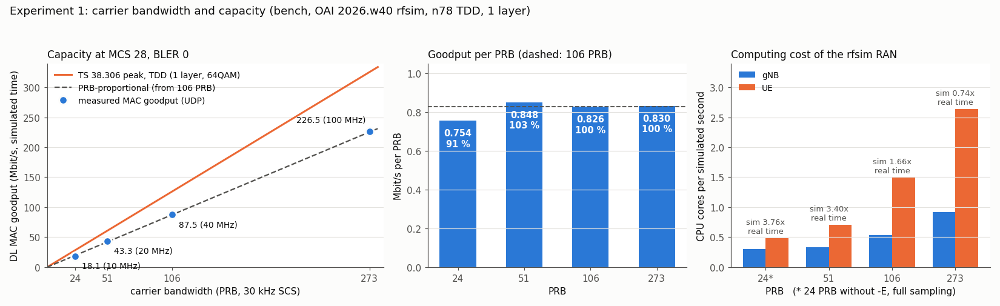

# Experiment 1: Carrier bandwidth (PRB count) and capacity

Status: **done** 2026-10-14 on the bench (branch `exp/01-bandwidth`). RF simulator mode only: the carrier is changed in
software for gNB and UE; nothing is transmitted. Teaching material: [Module 1](../training/MOD-01-bandwidth.md).

## Summary
| Question | Answer |
|---|---|
| Does capacity scale with the number of PRBs? | Almost: 51, 106 and 273 PRB deliver 0.83-0.85 Mbit/s per PRB; 24 PRB only 0.75 (91 % of proportional) |
| How far below the TS 38.306 peak rate is the bench? | 63-71 % of the TDD-adjusted 3GPP peak at every width |
| Can the bench run 100 MHz (273 PRB)? | Yes: 226.5 Mbit/s at MCS 28, BLER 0; the simulation then runs slower than real time (0.74x), at 184.32 MHz sampling |
| What does a wider carrier cost in computing? | UE: 0.5, 0.7, 1.5, 2.6 CPU cores per simulated second at 24, 51, 106, 273 PRB; gNB 0.3 to 0.9 |
| What broke on the way? | 24 PRB crashes the OAI gNB with 3/4 sampling (`-E`): 11.52 MHz is "not supported for numerology 1" in the PRACH code |



## Method
`infra/exp/exp01-bandwidth.sh` changes the carrier width of gNB and UE together, measures the DL capacity, and always
puts the 106 PRB repo configuration back at the end. For each width it:

1. Builds a temporary `gnb.yaml` with 7 changed values (SSB and point A ARFCN, carrier bandwidth DL/UL, initial BWP
   RIV DL/UL, CORESET0 index) and a UE command line with `-r`, `-C` (carrier centre) and `--ssb`; the values come from
   OAI's own configurations at tag 2026.w40 (`ci-scripts/conf_files`). The repo files are not touched.
2. Applies them (gNB first, then the UE) and waits for the UE tunnel and a ping to the core.
3. Runs 30 s of UDP downlink above the link rate (method of Experiment 0c) and reads MCS, BLER and MAC goodput from the
   dashboard's 1 s history, and the CPU time of `nr-softmodem` and `nr-uesoftmodem` from `/proc`.
   The FFT size is the one the gNB logs at start-up (`ofdm_symbol_size`, saved as `gnb-carrier-<PRB>.txt`); the sample
   rate is FFT size x 30 kHz.
4. PASS per width: at least `T - 12` MAC samples, DL MCS 27 or higher, BLER below 0.01, and the link saturated
   (UDP loss at least 5 %; otherwise the goodput is only a lower bound).

| PRB | Channel | Point A | SSB ARFCN | CORESET0 | RIV | UE `-C` (Hz) | UE `--ssb` | UDP offered | FFT size, sample rate |
|---|---|---|---|---|---|---|---|---|---|
| 24 | 10 MHz | 640032 | 640320 | 2 | 6325 | 3604800000 | 24 | 150M | 512, 15.36 MHz (full, no `-E`) |
| 51 | 20 MHz | 639996 | 640704 | 12 | 13750 | 3609120000 | 234 | 250M | 768, 23.04 MHz (`-E`) |
| 106 | 40 MHz | 620040 | 621312 | 11 | 28875 | 3319680000 | 516 | 200M | 1536, 46.08 MHz (`-E`) |
| 273 | 100 MHz | 626772 | 630048 | 12 | 1099 | 3450720000 | 1518 | 600M | 6144, 184.32 MHz (`-E`) |

## Runs
| Run | Widths | Result |
|---|---|---|
| `bench-bandwidth-20261014T103040Z` | 24, 51, 106 | 51 and 106 PASS; 24 FAIL (gNB crash, see Findings) |
| `bench-bandwidth-20261014T104026Z` | 24, 106 | PASS (24 PRB without `-E`) |
| `bench-bandwidth-20261014T110347Z` | 273, 106 | PASS |

A first run (09:47 UTC) offered too little UDP at 51 PRB (loss 0 %), so its 51 PRB value was only a lower bound; it is
not kept. That run is why the saturation check exists.

## Results
| PRB | MHz | MAC goodput | per PRB | vs PRB-proportional | vs 3GPP TDD peak | sim time / wall time | CPU per simulated s, gNB / UE |
|---|---|---|---|---|---|---|---|
| 24 | 10 | 18.1 Mbit/s | 0.754 | 91 % | 63 % of 28.6 | 3.76 | 0.30 / 0.49 (full sampling) |
| 51 | 20 | 43.3 | 0.848 | 103 % | 71 % of 60.8 | 3.40 | 0.33 / 0.71 |
| 106 | 40 | 87.5 (3 runs: 87.5, 87.5, 87.5) | 0.826 | 100 % (reference) | 69 % of 126.4 | 1.66 | 0.53 / 1.50 |
| 273 | 100 | 226.5 | 0.830 | 100 % | 70 % of 325.5 | 0.74 | 0.92 / 2.64 |

MCS 28 and BLER 0 at every width. "3GPP TDD peak" is the TS 38.306 clause 4.1.2 rate for 1 layer and 64QAM times the
DL share of our TDD pattern (104 of 140 symbols). "Sim time / wall time" is the iperf3 rate (wall clock) over the MAC
goodput (simulated time): above 1 the simulation runs faster than real time. "CPU per simulated s" is the measured CPU
load divided by that ratio: the CPU cores needed to simulate one second of radio.

## Findings
- **Capacity is proportional to the PRB count from 51 PRB up.** 51, 106 and 273 PRB give 0.826-0.848 Mbit/s per PRB;
  273 PRB lands within 0.5 % of the value scaled from 106 PRB. The 106 PRB reference gave 87.5 Mbit/s in all three runs.
- **The narrowest carrier loses 9 %.** 24 PRB carries 18.1 Mbit/s instead of 19.8. Hypothesis (Module 1, Section 3.5):
  overheads of fixed size (SSB 20 PRB x 4 symbols, CORESET0, SIB1) take a larger share of a small carrier.
- **51 PRB is 3 % above proportional.** Not predicted. Hypothesis, not tested: transport block size rounding or a
  different CORESET0/PDCCH size at this width; the per-slot TBS in the gNB log would separate the two.
- **The bench reaches 63-71 % of the 3GPP peak at every width**, the same ~40 % overhead found in Module 0 from the
  noise sweep (only ~60 % of the DL resource elements carry user data).
- **24 PRB needs full sampling.** With `-E` (3/4 sampling, used on the bench to save CPU) a 24 PRB carrier samples at
  11.52 MHz and the gNB stops at start-up: `Assertion failed in get_prach_ru_params(): sample rate 11.520000 MHz not
  supported for numerology 1`. The UE then only logs `connect() to 127.0.0.1:4043 failed`. The script drops `-E` from
  gNB and UE for 24 PRB only (both sides must use the same sample rate in rfsim).
- **Computing follows the sample rate, not the PRB count.** OAI picks the FFT size per width: 273 PRB (3276
  subcarriers) does not fit a 3/4-size FFT of 3072, so it uses 6144 points, 4 times the 1536 of 106 PRB for 2.6 times
  the PRBs. From 106 to 273 PRB the UE needs x 1.8 CPU per simulated second and the simulation falls below real time
  (0.74x). In rfsim this costs time, not errors; a real-time
  radio would need the full rate. The gNB/UE CPU percentages alone are misleading (90-250 % at every width) because the
  simulator always runs as fast as it can.
- **The downlink path buffers several seconds before it drops.** In every saturated UDP run the receiver saw no loss for
  the first 5-10 s (wall clock) although the offered rate was well above the link rate; then the loss jumped to its
  steady value. A queue of tens of MB fills first. Hypothesis: this is the queue that makes one TCP flow overshoot and
  lose packets in Experiment 0c (bufferbloat); where it sits (gNB RLC/PDCP, GTP-U, or the UE tunnel) is not known.
- At 24 PRB iperf3 ended with "unable to send control message" (its TCP control connection through the full queue);
  the script then takes the result from the per-second intervals (29 of 30 present).

## Reproduce
On REDLAB from the repo root, noise off, dashboard speed tests stopped, no dashboard controls meanwhile:
```
MODE=preview bash infra/exp/exp01-bandwidth.sh
BWS="24 51 106" MODE=run bash infra/exp/exp01-bandwidth.sh
BWS="273 106" MODE=run bash infra/exp/exp01-bandwidth.sh
python3 plot-bandwidth.py docs/experiments/img/EXP-01-bandwidth.png docs/experiments/data/bench-bandwidth-<run> [...]
```
`MODE=analyze OUT=docs/experiments/data/<run>` recomputes the summary of a finished run without touching the bench;
`MODE=restore` puts the 106 PRB repo configuration back. Each width restarts gNB and UE (about 1-2 min without a UE).


## Running Experiment 1 from the dashboard

Since the dashboard stages E1-E4 the lecturer can run this experiment from the dashboard (Experiments → 1 in the object tree); students only watch and fill in their tables.

1. Unlock the controls with the admin password in the toolbar. gNB and UE must be running.
2. Choose the bandwidth and press **Apply configuration**. The RAN profile relay (10.42.0.1:8093) writes the tested configuration, restarts gNB and UE and waits for the UE tunnel (about 25-30 s). If the UE does not come back, it returns to the 106 PRB baseline by itself.
3. Press **UDP downlink (capacity)**. The offered load follows the profile (150M / 250M / 200M / 600M for 24 / 51 / 106 / 273 PRB). Wait until the goodput chart has been flat for 20 s.
4. Press **Record**: the dashboard stores the mean of the last 20 s (SINR, CQI, MCS, BLER, UL PRB, goodput), the offered rate and the DL loss. A DL loss of 5 % or more shows that the link was saturated.
5. Repeat for **UDP uplink** (offered load is half the DL rate) and, if wanted, **TCP downlink** (one flow).
6. Download the CSV. Press **Return to baseline** at the end.

Bench check of this path: `MODE=check bash infra/dash/exp-api.sh` (with `FULL=1` it also switches to 51 PRB and back).

Dashboard results (2026-10-15/16, rfsim, noise off): UDP DL 87.5 Mbit/s at 106 PRB and 43.3 Mbit/s at 51 PRB, the same as the scripted run above; DL loss 35.8 % at 200M offered (saturated).
First uplink measurement: **UDP UL 35.3 Mbit/s at 106 PRB** (MCS 28, BLER 0, 100M offered), about 85 % of the TS 38.306 estimate of 41.6 Mbit/s, while the downlink reaches about 69 % of its estimate.
Hypothesis: the uplink carries less overhead (no PDCCH, SSB or CSI-RS in the UL symbols). Not yet proven: the UL loss is seen only by the server on the core, so UL saturation is not checked yet.

## Lessons
- Check that a UDP capacity test saturates the link (loss > 0) before reading its rate; rfsim's speed changes with the
  carrier width, so a fixed offered rate can fall below the capacity.
- When the UE cannot connect to the rfsim server, read the gNB log first: the gNB may have stopped at start-up.
- After a reboot of REDLAB, wait for k3s, the gNB and the UE tunnel before running a preview.

## Open
- Why 51 PRB is 3 % above proportional (TBS or CORESET), and how the ~40 % overhead splits (Experiments 3 and 6).
- Where the multi-second DL buffer sits, and whether limiting it fixes single-flow TCP (Experiment 0c follow-up).
- The UE CPU at 273 PRB: which thread limits the simulation (it uses ~2 cores of the 2.6 needed for real time).
