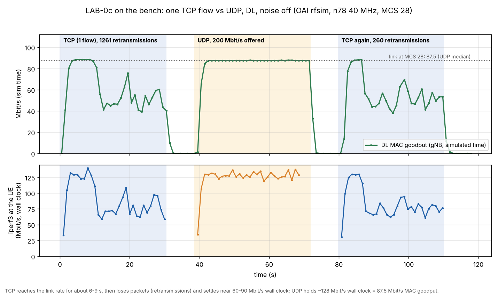

# LAB-0: Downlink noise presets and dashboard control

Status: **done** (2026-10-08 to 2026-10-11; rerun on the bench 2026-10-14, see "Bench rerun"). Commits `6a37bdc` to `dba4729` on `main`; timeline experiment 2026-10-11 (PR `lab/00-noise-presets`).

## Goal
Offer three repeatable downlink channel conditions (Clean, Moderate, Poor) and switch between them
from the dashboard, so the effect on CQI, MCS and throughput can be shown live.

## Method
- AWGN on the UE receive path through the OAI channel model (`channelmod`, model 0), changed through
  the OAI telnet server on 127.0.0.1:9090. rfsim only.
- `exp-noise.sh` sweeps `noise_power_dB`, idle and with the DL speed test, and saves raw statistics and logs.
- Each preset was confirmed with 6 x 10 s samples (first discarded), same RNTI, always in-sync.

## Results
| Preset | `noise_power_dB` | CQI | DL MCS | DL MAC goodput |
|---|---|---|---|---|
| Off | -100 | 15 | 28 | ~78-86 Mbit/s |
| Clean | -11 | 14 | 26 | ~84 Mbit/s |
| Moderate | -6.5 | 9 | 15 | ~39.7 Mbit/s |
| Poor | -3 | 5 | 6 | ~14.3 Mbit/s |

Reproduced on the baseline UE after the integration (`run-20261010T144928Z`). The gNB uses the 64QAM
MCS table (TS 38.214 Table 5.1.3.1-1). Down to -2 dB there was no link loss.

## Integration
1. **Stage A** `ue-chanmod.sh`: the baseline UE carries the channel model (AWGN, -100 dB) and telnet on 127.0.0.1.
2. **Stage B** `noise-relay.py`: a relay on FCT0173 (10.0.129.7:8092) that accepts only the four preset
   names and a shared token; no Kubernetes API access.
3. **Stage C** dashboard v0.8.0: Controls bar "DL channel: Off / Clean / Moderate / Poor".

Tests: `noise-relay.sh` MODE=test PASS; `d6-test.sh` step 6b (Moderate gives MCS 15, Off gives MCS 28) PASS;
`iperf-regress.sh` and `uu-check.sh` PASS.

## Timeline: presets switched during a running DL speed test
`exp-noise-timeline.sh` keeps the DL speed test running and switches Off, Clean, Moderate, Poor, Off every 40 s
through the noise relay (the same path as the dashboard buttons). It samples the gNB MAC statistics and the UE SINR
about every 1.4 s and records the time of every switch. Run `timeline-20261011T160138Z`: **RESULT: PASS**
(every phase in its MCS range, one UE context `607b` throughout, no out-of-sync sample).


Raw data: [`data/timeline-20261011T160138Z/`](data/timeline-20261011T160138Z/). Medians per phase (samples from 10 s after the switch, 22 per phase):

| Phase (switch time) | `noise_power_dB` | UE SINR | CQI | DL MCS | DL MAC goodput |
|---|---|---|---|---|---|
| Off (0.0 s) | -100 | 45.1 dB | 15 | 28 | 90.3 Mbit/s |
| Clean (40.3 s) | -11 | 21.6 dB | 14 | 26 | 84.1 Mbit/s |
| Moderate (80.6 s) | -6.5 | 13.3 dB | 9 | 15 | 39.7 Mbit/s |
| Poor (120.9 s) | -3 | 5.6 dB | 5 | 6 | 14.3 Mbit/s |
| Off (161.5 s) | -100 | 45.1 dB | 15 | 28 | 90.3 Mbit/s |

Observations (from this run):
- The chain is visible end to end: more noise lowers the UE SINR, the UE reports a lower CQI, the gNB picks a lower MCS,
  and the goodput falls. CQI, MCS, BLER and goodput change; the UE stays attached and in sync.
- A switch takes 1.0-1.5 s through the relay. CQI and MCS follow in the first or second sample after it.
- Going down, MCS drops in one step (26 to 15, 15 to 6). Going back up to Off, CQI is 15 at once but MCS climbs over
  about 5 s (7, 13, 25, 28 between 163.0 and 167.1 s). Hypothesis, not tested: the gNB raises MCS gradually after a low-BLER period.
- BLER rises briefly after the switches to worse channels (peak 0.027 at Moderate, 0.006 at Poor) and falls below 0.001
  within about 8 s; at Clean it stays 0.
- Goodput reaches the new level 2-8 s after a switch, later than MCS; the goodput value appears to be averaged over a
  window (hypothesis).
- Off gave 90.3 Mbit/s here, above the 78-86 Mbit/s in the table above (different runs and days).

Reproduce (from FCT0170):
```
ssh fct0173 'bash -s' < ~/rdt/exp-noise-timeline.sh
# copy timeline.csv and events.csv from the run folder it names, then:
python3 plot-noise-timeline.py docs/labs/data/timeline-20261011T160138Z docs/labs/img/LAB-00-noise-timeline.png
```
Do not press the dashboard DL channel buttons while it runs (about 4 minutes).

## Bench rerun (2026-10-14)
The testbed moved to the bench (core on the P3 Tiny, RAN on REDLAB, OAI 2026.w40, UE with the channel model since stage 4d).
`infra/lab/lab00-timeline.sh` repeats the timeline above with the same schedule, CSV format and phase checks; the
switches go through the dashboard API and the samples come from the dashboard's 1 s history.
Run `bench-timeline-20261014T013731Z`: **RESULT: PASS** (every phase in its MCS range, one UE context `c79d`,
no out-of-sync sample, 200 samples).


Medians per phase (samples from 10 s after the switch, 30 per phase), next to the first run on the old lab:

| Phase | `noise_power_dB` | UE SINR bench / old | CQI | DL MCS | DL MAC goodput bench / old |
|---|---|---|---|---|---|
| Off | -100 | 45.1 / 45.1 dB | 15 / 15 | 28 / 28 | 48.4 / 90.3 Mbit/s |
| Clean | -11 | 22.1 / 21.6 dB | 14 / 14 | 26 / 26 | 44.6 / 84.1 Mbit/s |
| Moderate | -6.5 | 13.8 / 13.3 dB | 9 / 9 | 15 / 15 | 38.8 / 39.7 Mbit/s |
| Poor | -3 | 6.2 / 5.6 dB | 5 / 5 | 6 / 6 | 14.0 / 14.3 Mbit/s |
| Off | -100 | 45.1 / 45.1 dB | 15 / 15 | 28 / 28 | 45.8 / 90.3 Mbit/s |

Findings:
- **The presets carry over unchanged.** UE SINR within 0.6 dB, CQI and MCS identical in every phase: no recalibration needed.
- **The radio is not what limits Off and Clean on the bench.** At Moderate and Poor the goodput is flat (38.8 and 14.0,
  the same as on the old lab): there the MCS sets the rate. At Off and Clean it swings between about 30 and 77 Mbit/s
  (p10-p90 39.6-70.5 at Off) with MCS 28 and BLER 0. Right after the switch back to Off the goodput reached 83-88 Mbit/s
  for about 4 s (162.8-165.8 s) and then fell back to about 40-50: the queue that built up during Poor drained at the
  full rate. So the link carries about 88 Mbit/s at MCS 28 (as on the old lab), and in steady state the DL speed test
  (one TCP flow, iperf3 `-R`) does not keep the gNB queue full. Hypothesis, to be tested before LAB-1: the TCP flow is
  limited by its sender or round-trip time through rfsim (or the core path), not by the scheduler; a UDP test at a fixed
  rate above 88 Mbit/s separates the two.
- Consequence for the KPIs: the stage 3 baseline (DL 50.9 Mbit/s) is this TCP-limited rate, not the radio capacity.

Reproduce (on REDLAB, repo root, about 3.5 min, no dashboard controls meanwhile):
```
MODE=run bash infra/lab/lab00-timeline.sh
python3 plot-noise-timeline.py docs/labs/data/bench-timeline-<time> docs/labs/img/LAB-00-bench-timeline.png "LAB-0 on the bench: ..."
```

## LAB-0c: one TCP flow vs UDP (2026-10-14)
Question from the bench rerun: is the DL speed test (one TCP flow) what keeps the goodput near 50 Mbit/s at Off?
`infra/lab/lab00c-tcp-udp.sh` runs three DL phases of 30 s with noise off through a temporary iperf3 client pod bound
to `oaitun_ue1` (server 10.45.0.1:5202, `-R`): TCP, UDP at 200 Mbit/s offered (wall clock), TCP again.
Run `bench-tcpudp-20261014T025110Z`: **RESULT: PASS** (all phases complete, one UE context `c79d`, no out-of-sync).
**Verdict: hypothesis supported.**



| Phase | iperf3 at the UE (wall clock) | MAC goodput median (p90), sim time | DL MCS | DL BLER |
|---|---|---|---|---|
| TCP | 89.0 Mbit/s, 1261 retransmissions | 54.6 (88.4) Mbit/s | 28 | 0 |
| UDP, 200 Mbit/s offered | ~128 Mbit/s received (27.4 % lost) | 87.5 (87.7) Mbit/s | 28 | 0 |
| TCP again | 82.7 Mbit/s, 260 retransmissions | 49.8 (69.6) Mbit/s | 28 | 0 |

Findings:
- The link carries **87.5 Mbit/s** of MAC goodput at MCS 28, steady, with BLER 0: the same as the old lab (~88-90).
  Use UDP at a fixed rate above the link rate when a lab measures capacity (LAB-1 onwards).
- One TCP flow reaches that rate for about 6-9 s after its start (MAC 88 Mbit/s, iperf3 ~130 Mbit/s wall clock), then
  loses packets (1261 and 260 retransmissions) and settles at 60-90 Mbit/s wall clock, about 40-60 Mbit/s of MAC
  goodput. The radio stays at MCS 28 and BLER 0 throughout, so the losses are not on the air interface.
  Hypothesis, not tested: a queue on the path (gNB RLC/PDCP buffer, GTP-U or the UE tunnel) overflows when TCP fills
  it, and TCP (CUBIC) backs off and recovers slowly over the long round trip of the simulated link.
- Wall clock vs simulated time in this run: 128 / 87.5 = about 1.46.
- The dashboard speed test stays TCP on purpose (it shows what one application flow gets). The stage 3 baseline
  (50.9 Mbit/s) and the KPI targets built on it describe that TCP flow, not the radio capacity.

Reproduce (on REDLAB, repo root, about 2.5 min, dashboard speed tests stopped, no controls meanwhile):
```
MODE=run bash infra/lab/lab00c-tcp-udp.sh
python3 plot-tcp-udp.py docs/labs/data/bench-tcpudp-<time> docs/labs/img/LAB-00c-tcp-udp.png
```

## Lessons
- `lab0-run.sh` re-creates the UE from `ran/oai-nr-ue-deploy.json`: change the source file, and run lab0 in the test.
- With no DL traffic the gNB reports MCS 0, goodput 0 and a decaying BLER; that is the idle state.
- A slow relay (fixed waits, two telnet sessions) made the dashboard time out although the noise was applied;
  the relay test now fails if a change takes 5 s or more.

## Open
- Steady-state UL goodput read 25-38 Mbit/s in the gates vs ~49 documented: to be measured.
- Add the active preset as a column in the KPI CSV export.
